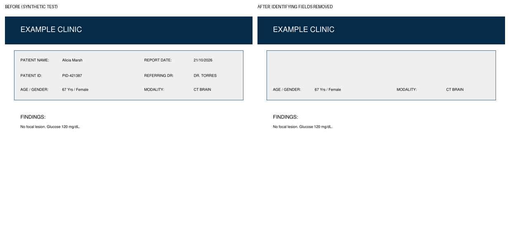

# Health-DeID

Authenticated admin → clean report without identifying fields → doctor review → admin restoration, based on the uploaded Streamlit application and architecture diagram.

## Run locally

Use Python 3.12 (the tested version). From this directory:

```sh
python -m venv .venv
```

Activate with `source .venv/bin/activate` on Linux/macOS, or `.\.venv\Scripts\Activate.ps1` in Windows PowerShell. Then:

```sh
python -m pip install -r requirements.lock
python manage_users.py admin --role admin
python manage_users.py doctor --role doctor
```

Both commands prompt privately for a password of at least 12 characters. There are no default accounts or public account creation. Copy `.env.example` to `.env` and set `GOOGLE_API_KEY` locally. Then:

For scanned PDFs and images, install [Tesseract OCR](https://tesseract-ocr.github.io/tessdoc/Installation.html). It supplies independent word positions so approximate AI boxes cannot leave pieces of names or IDs behind. Digital PDFs with native text positions do not need Tesseract. Standard Windows installation paths are detected automatically; otherwise set `TESSERACT_CMD` in `.env`. For non-English scans, install the corresponding Tesseract language data and set `DEID_OCR_LANG` (for example `eng+hin`). On Ubuntu, use `sudo apt-get install tesseract-ocr`.

```sh
python -m streamlit run app.py
```

Each cloud task already has an isolated environment. Use its existing checkout; do not create a Git worktree unless explicitly requested. Running services must be started again in a new machine.

## Workflow

1. Sign in as admin. Upload PDF, PNG, JPEG, or UTF-8 text (up to 25 MiB; PDFs up to 30 pages).
2. Scan the report. Every PDF page is rendered and sent separately to Google Gemini for PHI detection. Real PDF text positions or local Tesseract OCR word positions align each detection. Local rules add IDs, phone numbers, email addresses, and numeric dates.
3. Review detections page by page. Add missing PHI and correct locations in the editor. Coordinates are normalized to 0–1000: top, left, bottom, right. Selections include the identifying label and complete value. All occurrences are located, even when the model returns only one box for a repeated name. Empty OCR responses, unaligned text, invalid boxes, and failed AI calls block processing; simulated output is never substituted.
4. Select Preview clean report. Identifying values and adjacent identifying labels (such as PATIENT NAME, PATIENT ID, REPORT DATE, REFERRING DR) disappear. The surrounding white, grey or coloured background fills the space. There are no visible black blocks, PHI tokens or REDACTED labels. Clinical tables, text, and page geometry outside these regions retain their visible layout. Confirm review, then share.
5. Sign in as doctor. Download the clean report, write clinical notes without identifying information, and return the report to admin.
6. Sign in as admin and open Returned reports. Restore the original report. The download is the byte-identical original, including its original format/layout, decrypted from the private vault. Doctor notes remain separate and are downloadable, so the original sheet is not modified. The doctor’s shared copy remains de-identified.

Example using a synthetic report (not patient data):



## Storage and masking technology

- Public copies use **permanent field erasure and background reconstruction**, with all output metadata discarded. White, grey and other flat backgrounds are matched from pixels outside every PHI selection. Textured backgrounds use local OpenCV inpainting after sensitive pixels are destroyed. Clinical text is never generated or rewritten. PDF output is a new document containing only sanitized page images. Source text layers, embedded files, links, and annotations are not copied. JPEG uploads are shared as lossless PNG images.
- Layout preservation means visual layout, page dimensions, and content outside the removed fields. Shared PDFs are rasterized at 144 DPI, so their original searchable/selectable text, forms, and signatures are not retained as interactive objects. Public UTF-8 text omits identifying fields and empty lines. Complex backgrounds or fields intersecting table borders may need manual selection corrections; the software does not guarantee forensic invisibility of editing.
- Reversibility uses **private token mappings plus an encrypted original**. Tokenized restoration text stays inside the encrypted vault, so the public copy does not contain placeholders. The shared file contains neither the original bytes nor the private map. Previously stored tokenized reports can still be restored.
- `.deid-data/vault.sqlite3` contains AES-256-GCM encrypted originals and mappings. Each record has a random nonce and its document reference is authenticated as associated data. `.deid-data/vault.key` is generated locally with restrictive file permissions. Protect and back up this key separately; losing it prevents restoration. This is a local-development key store, not an external key-management service.
- `.deid-data/shared.sqlite3` stores masked reports, masked text, review notes, status, and audit events. Original filenames remain private because filenames can contain patient information. No AI reasoning or unfiltered clinical summaries are published.
- `.deid-data/auth.sqlite3` stores salted scrypt password hashes and hashed, expiring session tokens. The backend checks each operation’s role; choosing a role in the browser cannot grant access. Sign out revokes the session.
- The original uploaded `phi_vault.json` and `shared_db.json` are **not imported** or bundled. They may contain sensitive data and lack the protections of this workflow. Preserve them privately for a separate, reviewed migration.

AI detection can miss or misplace identifiers. Manual review is required before sharing. No accuracy or regulatory compliance certification is claimed. Real-world deployment needs an appropriate approved AI processing arrangement, HTTPS, managed key storage, backups, and institution-specific access and retention policies.

## Validation

```sh
python -m pip install -r requirements-dev.txt
python -m pytest tests -q
```

Tests generate synthetic documents and inject deterministic AI detection results. Actual Tesseract OCR is used in scanned-document tests. They exercise digital/scanned multipage PDFs, full field and label removal, grey-background matching, shifted model coordinates, image metadata removal, repeated PHI, pixel/layout preservation, old/new text restoration, encrypted storage, tamper detection, missing keys, failed detection, role checks, and the Streamlit login/review/restoration flow. They do not measure the live model’s PHI recall. Live Google detection requires a valid API key and provider access.

See [UPGRADE.md](UPGRADE.md) when replacing an earlier black-box version. The update applies to newly generated reports; already shared attachments are not rewritten automatically.
